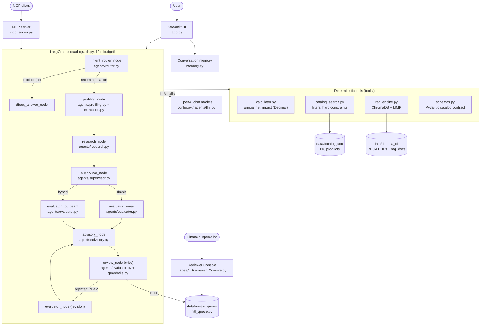

# Architecture

This guide follows one query through the code. It is the map between the
capstone design documents (listed in the [README](../README.md#design-documents))
and the modules that implement them.

## System view



**The core rule: the LLM never computes money.** Every MXN figure and rate
comes from `tools/calculator.py`. The LLM extracts preferences, writes the
narrative and critiques the draft. Deterministic code checks each of those
outputs before it is used.

## One query, step by step

`run_squad()` in `graph.py` runs the compiled graph in a worker thread with a
hard timeout (budget + 2 s grace). `supervised()` in `agents/supervisor.py`
wraps every node: it checks the remaining budget, records per-node latency and
appends to `trajectory_log`.

1. **Resources** (`graph.py::build_default_resources`) — loaded once, outside
   the budget:
   - the catalog, validated with `load_catalog(strict=True)`;
   - the ChromaDB index;
   - a warm embedding model;
   - the LLM client.
2. **Intent routing** (`agents/router.py`) — a question about one named
   product ("What is the monthly fee of LikeU Pro?") is answered straight from
   the catalog by `direct_answer_node`. Anything else goes to the squad.
3. **Profiling** (`agents/profiling.py`, `agents/extraction.py`):
   - A deterministic parser reads the deposit, the hard constraints (zero fee,
     digital opening, minor under guardianship, ...) and the stated
     objectives.
   - The LLM proposes the archetype and raw weights. `extraction.py` verifies
     them against the parser and falls back to rule-based weights when they
     disagree or when the LLM is off.
   - The result is the preference vector `w = [yield, fee, perks]` (sums to
     1.0), plus `query_complexity` (simple / hybrid).
4. **Research** (`agents/research.py`):
   - **Branch A** filters the catalog by the hard constraints.
   - **Branch B** retrieves RECA clauses with MMR (k = 4, fetch 20,
     λ = 0.5), only for the top 10 finalists by structured score, and filters
     by institution, product and document type.
   - `guardrails.detect_api_rag_conflicts` then compares catalog figures with
     the figures stated in the retrieved clauses.
5. **Supervisor** (`agents/supervisor.py`) — routes `simple` queries to the
   linear evaluator and `hybrid` ones to the Tree-of-Thought beam.
6. **Evaluation** (`agents/evaluator.py`):
   - Score per product:

     ```text
     score = 100 · (w_yield·yield_metric + w_fee·fee_metric + w_perks·perks_metric) − net_cost_penalty
     ```

     - `yield_metric` is the net after-tax yield divided by 10 %.
     - `fee_metric` is 1 − annual fees / MXN 2,400.
     - `perks_metric` comes from the catalog's perk flags.
     - `net_cost_penalty` only applies when the account loses money. Its size
       depends on the archetype: up to 25 points for Basic, 20 for Saver,
       15 for Flow and 5 for Lifestyle.
   - The **ToT beam** (width 5, depth 3) runs three stages:
     1. product selection;
     2. yield assessment, with a stress balance at 80 % of the deposit;
     3. benefits and fees, with SPEI channel fit and benefit verification.
   - Adjustments:
     - data older than 30 days is down-weighted × 0.8;
     - conflicted products lose 10 points;
     - branches within 5 points are re-ranked by strict constraint adherence
       (that is why `final_rank` is not always score order).
   - Confidence:

     ```text
     confidence = 0.45·score/100 + 0.20·constraints_met + 0.15·fresh + 0.10·evidence + 0.10·separation − 0.20·conflict
     ```

7. **Advisory** (`agents/advisory.py`):
   - The skeleton is deterministic:
     - **Base Option** — the best-ranked account with zero annual fees;
     - **Positive Trade-off** — the highest net impact above the Base Option;
     - an explicit explanation when the top-scoring account is neither;
     - supporting clauses, warnings and disclaimers.
   - The LLM only writes the narrative, from `verified_facts`.
8. **Review** (`review_node` + `guardrails.py`):
   - Deterministic checks run first:
     - every number in the narrative must match a verified figure;
     - no overconfident wording;
     - no perk the catalog does not have;
     - no internal identifiers (field names such as `accounts_compared`,
       or product keys).
   - A grounded LLM critic can add issues.
   - A rejected draft is revised at most `MAX_REVISIONS = 2` times; after that
     the case goes to a human.
9. **Human in the loop** (`guardrails.human_review_reasons`, `hitl_queue.py`)
   — a case is escalated on any of these:
   - confidence < 0.70;
   - balance > MXN 100,000;
   - an unresolved catalog/RECA conflict;
   - an exhausted critique loop;
   - a timeout.

   Escalated cases are written to an append-only JSONL queue (free text is
   PII-redacted). A specialist decides them in the Reviewer Console.
   Final decisions (approve / modify) feed `golden_dataset.jsonl`.

## Conditional bypasses

Coordinating several LLM agents is expensive in latency and tokens. The graph
avoids model calls whenever code can already settle the routing or the
answer. Each bypass is a plain condition checked before the call, and
`trajectory_log` records it.

| Condition (decided in code) | Where | What is skipped |
|---|---|---|
| Question about one named product ("What is the monthly fee of LikeU Pro?") | `agents/router.py::intent_edge` → `direct_answer_node` | The whole squad: the answer comes straight from the catalog |
| Exactly one archetype cue in the query | `agents/profiling.py::rules_are_conclusive` | The profiling / extraction LLM call |
| Query classified as `simple` | `agents/supervisor.py::router_edge` | The Tree-of-Thought beam (linear scoring instead) |
| No product meets the hard constraints | `agents/advisory.py::advisory_node` (no Base Option) | The narrative LLM call (template + criteria negotiation) and, as a result, the LLM critic |
| A branch meets 100 % of the hard constraints with score > 85 | `agents/evaluator.py::_early_stop` | ToT depths 2 and 3 |
| The deterministic review already found issues | `agents/evaluator.py::review_node` | The LLM critic (the issues go straight to the revision) |
| The narrative came from the template | `agents/evaluator.py::_llm_critique` | The LLM critic |
| Not enough budget left for a call | `ctx.has_budget(...)` in profiling, advisory and the critic | That call; the deterministic fallback is used |
| Draft approved, or the revision limit is reached | `agents/supervisor.py::review_router_edge` | Further revision rounds |

The ToT beam itself never calls the LLM. Its early stop saves time in the
10-second budget, and that spare time is what lets the advisory narrative use
the LLM instead of falling back to the template.

## Agents

| Agent | Module | Responsibility |
|---|---|---|
| Supervisor / Orchestrator | `agents/supervisor.py`, `graph.py` | Budget, routing, revision loop, observability |
| Profiling & Dialogue | `agents/profiling.py`, `agents/extraction.py`, `memory.py` | Preference vector, constraints, multi-turn memory |
| Market & Policy Research | `agents/research.py`, `tools/rag_engine.py` | Structured filter + RECA retrieval |
| Evaluator & Trade-off Reconciliation | `agents/evaluator.py` | Scoring, ToT beam, confidence, critic |
| Consultative Advisory | `agents/advisory.py`, `prompts/advisory_prompts.py` | Options, narrative, abstention protocol |

## Safety layers

| Layer | Code | What it does |
|---|---|---|
| Data contract | `tools/schemas.py` | Strict Pydantic validation of every catalog product; audit warnings |
| Deterministic money | `tools/calculator.py` | Decimal arithmetic, ISR withholding, fee waivers, SPEI by channel |
| Input verification | `agents/extraction.py` | LLM-extracted parameters are re-checked by the parser |
| Freshness & abstention | `state.py`, `guardrails.assess_abstention` | Evidence older than 30 days → provisional answer with warnings |
| Source conflicts | `guardrails.detect_api_rag_conflicts` | Catalog vs RECA fee, waiver and rate mismatches |
| Draft review | `guardrails.review_draft`, `review_node` | Faithful numbers, no invented perks, no overconfident language, no internal identifiers |
| Fallback | `graph._timeout_fallback` | Hard timeout → cached zero-fee baseline + disclaimers |
| Human review | `hitl_queue.py`, `pages/1_Reviewer_Console.py` | Escalation queue, approve / modify / escalate |

## Memory

`memory.py` keeps a typed `ConversationProfile` with the deposit, constraints,
exclusions and weights, plus a sliding window of turns. Turns that leave the
window are summarized by the LLM, or by a template when it is off. A follow-up
message ("make it digital", "forget the minor account") becomes a delta on
that profile instead of a new profile.

## Evaluation

The evaluation lives in `evaluation/`:
- `dataset_generator.py` builds the 15-case synthetic benchmark (the four
  archetypes, edge cases, stale data and HITL triggers);
- `custom_evaluators.py` holds the KPI evaluators;
- `langsmith_runner.py` runs them as LangSmith experiments, or locally.

| KPI | Evaluator | Target |
|---|---|---|
| RAG Triad faithfulness | deterministic claim check + LLM judge | ≥ 0.95 |
| Exact-match arithmetic | recomputes every figure with the calculator | 100 % |
| Expected Calibration Error | confidence vs outcome accuracy | < 0.05 |
| Freshness safety violations | definitive answers on stale data | 0 % |
| P95 latency | end-to-end wall time | < 8 s |

`evaluation/sample_results/` keeps one full run. `tests/test_evaluators.py`
injects faults to show that each evaluator catches them.

## Swap points

- **Chat models** — set per task in `config.TASK_MODEL_DEFAULTS`, or through
  `DEBITMATCH_MODEL_<TASK>` in `.env`. Agents depend on the `StructuredLLM`
  protocol (`agents/llm.py`), so tests can inject fakes.
- **Embeddings** — `text-embedding-3-small` (`tools/rag_engine.py`). The
  model name is stored in the collection metadata, and a mismatch asks for a
  rebuild with `ingest_docs.py --reset`.
- **Catalog** — `data/catalog.json` is the only structured source. Anything
  that passes `load_catalog(strict=True)` can replace it.
- **Interface** — the same tools are exposed through MCP (`mcp_server.py`,
  stdio), so the squad can run without Streamlit.
